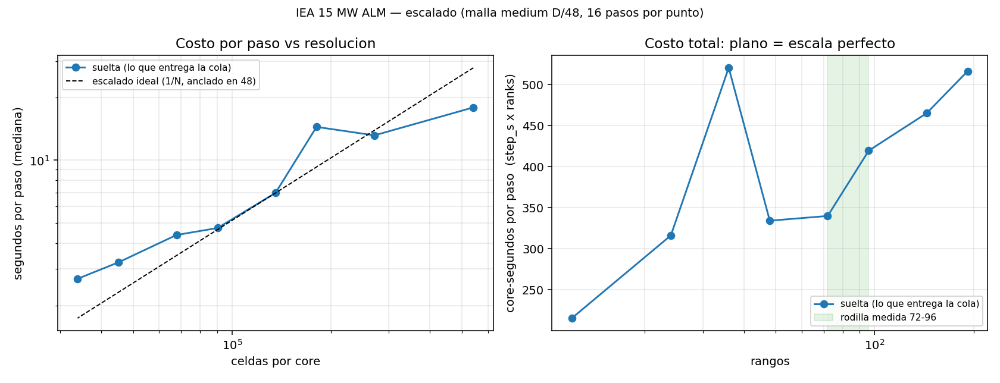
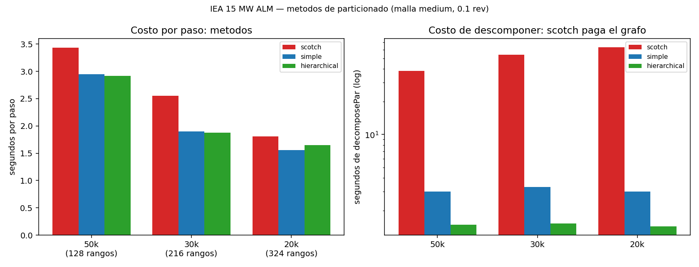

# IEA 15 MW — rendimiento del HPC (escalado y particionado)

Generado por `tools/plot_hpc_performance.py` desde los CSV de los estudios;
re-ejecutarlo actualiza tablas y graficos (por ejemplo cuando entre la curva
densa). **No editar a mano.**

## Escalado

Malla medium D/48 (6.508.528 celdas), 16 pasos por punto (0,1 rev),
mediana de los deltas de `ExecutionTime`. `core-segundos` es el costo
de un paso: plano = escalado perfecto.

### Asignación suelta (sólo `--ntasks`: la coloca el planificador)

| rangos | celdas/core | s/paso | core-s/paso | min/rev | 4 revs | pared |
|---|---|---|---|---|---|---|
| 12 | 542,377 | 17.94 | 215 | 47.84 | 3.19 h | 396 s |
| 24 | 271,188 | 13.17 | 316 | 35.12 | 2.34 h | 308 s |
| 36 | 180,792 | 14.46 | 521 | 38.56 | 2.57 h | 411 s |
| 48 | 135,594 | 6.96 | 334 | 18.56 | 1.24 h | 230 s |
| 72 | 90,396 | 4.72 | 340 | 12.59 | 0.84 h | 203 s |
| 96 | 67,797 | 4.37 | 420 | 11.65 | 0.78 h | 216 s |
| 144 | 45,198 | 3.23 | 465 | 8.61 | 0.57 h | 206 s |
| 192 | 33,898 | 2.69 | 516 | 7.17 | 0.48 h | 256 s |

Los **absolutos** de esta curva están inflados por la colocación dispersa; sirven para la forma, no para planificar tiempos.

> La curva densa todavía no corrió (`11610449` en cola): es la que fija los absolutos.

## Métodos de particionado

Mismos puntos (0,1 rev) con la misma asignación dentro de cada densidad,
así que el **ratio** entre métodos es limpio aunque los absolutos no.

| celdas/core | rangos | método | s/paso | vs scotch | decomposePar |
|---|---|---|---|---|---|
| 50,847 | 128 | scotch | 3.43 | 1.00 | 38.3 s |
| 50,847 | 128 | simple | 2.95 | 0.86 | 3.0 s |
| 50,847 | 128 | hierarchical | 2.92 | 0.85 | 1.5 s |
| 30,132 | 216 | scotch | 2.55 | 1.00 | 54.0 s |
| 30,132 | 216 | simple | 1.90 | 0.75 | 3.3 s |
| 30,132 | 216 | hierarchical | 1.88 | 0.74 | 1.5 s |
| 20,088 | 324 | scotch | 1.81 | 1.00 | 63.0 s |
| 20,088 | 324 | simple | 1.56 | 0.86 | 3.0 s |
| 20,088 | 324 | hierarchical | 1.65 | 0.91 | 1.4 s |

## Qué NO dicen estos números

- La curva suelta mezcla la colocación con la resolución: cada slice puede
  caer en nodos distintos (las mismas 192 tareas fueron a 4 nodos en una
  asignación y a 21-33 en otras). Por eso existe la curva densa.
- Los puntos de pocos rangos (36/24/12) salieron **no monótonos** (36 rangos
  peor que 48 y que 24): ahí domina el ruido de colocación y no sirven para
  decidir.
- El horizonte de las corridas es 0,1 rev por punto: mide costo por paso, no
  convergencia física.
